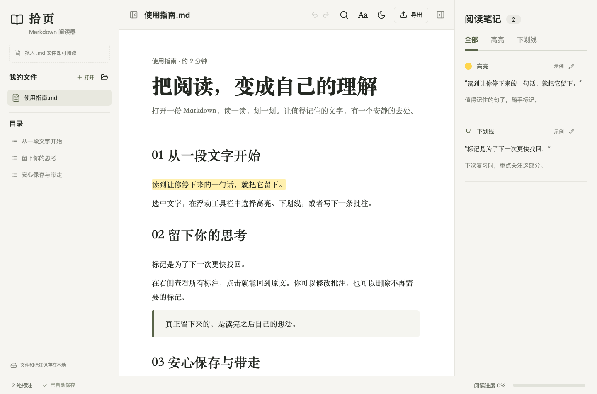

# 拾页 · Markdown 阅读器

打开 Markdown，选中文字就能高亮、加下划线、写批注。文件、标注与阅读位置自动保存在本机。

**[下载 Mac 测试版](https://github.com/albertchanchan59-oss/shiyue-markdown-reader/releases/tag/v1.0.1)** · **[下载离线网页版](https://github.com/albertchanchan59-oss/shiyue-markdown-reader/releases/download/v1.0.1/shiyue-reader-1.0.1.html)**



## 能做什么

- 四种颜色高亮、下划线、批注，支持撤销和重做。
- 打开多个 Markdown 文件、导入文件夹及相对路径图片。
- 章节目录与全文搜索，左右侧栏独立展开或收起。
- 调整字号、行距和阅读宽度，切换深色模式。
- 自动保存标注和阅读位置，导出阅读存档、带标注的 HTML、Markdown 笔记及 PDF。
- 阅读本地文件无需账号和网络。原文中的网络图片会按地址加载。

## 安装与使用

### Mac 应用

1. 在 [v1.0.1 下载页](https://github.com/albertchanchan59-oss/shiyue-markdown-reader/releases/tag/v1.0.1) 下载 `shiyue-1.0.1-universal.dmg`。
2. 打开 DMG，将「拾页」拖入 Applications（应用程序）。
3. 从应用程序启动拾页，点击「我的文件」旁的「打开」，或把 Markdown 文件拖进窗口。

支持 **macOS 13 及以上、Apple 芯片与 Intel**，使用时无需安装 Node.js。

**当前为测试版：安装包尚未使用 Apple Developer ID 发布证书签名，也未完成 Apple 公证。** 从网络下载后，macOS 首次打开可能会拦截；在确认来源后，可到「系统设置 → 隐私与安全性」查看「仍要打开」入口。下载页附安装说明和 SHA256 校验值。

### 离线网页版

下载 [shiyue-reader-1.0.1.html](https://github.com/albertchanchan59-oss/shiyue-markdown-reader/releases/download/v1.0.1/shiyue-reader-1.0.1.html)，双击并用 Chrome 打开。这个文件包含完整阅读器，无需安装、服务器或网络。

Mac 应用与网页版各自保存资料。网页版的资料属于当前浏览器和打开入口；切换入口、换电脑或清除浏览器数据前，请导出阅读存档。

## 阅读与标注

1. 选中文字，在浮动工具栏选择颜色高亮、`U` 下划线或批注图标。
2. 在右侧「阅读笔记」查看、编辑或删除标注；点击标注可回到原文。
3. 正文顶部两端的按钮可独立收起或展开左右侧栏；目录可以单独滚动。
4. 带本地图片的文章，请点击「我的文件」旁的文件夹图标，选择文章所在文件夹。
5. 再次打开内容相同的文件，会保留已有标注；原文改动后会作为新文档导入。

## 备份与导出

| 导出格式 | 用途 |
| --- | --- |
| 阅读存档 `.shiyue` | 完整原文、标注、批注与已导入图片；打开即可恢复 |
| 带标注的 `.html` | 保留排版与标注，双击阅读，末尾附批注 |
| 阅读笔记 `.md` | 汇总标记过的句子和自己的想法 |
| 原始 Markdown | 保留导入时的原文 |
| 打印 / 保存 PDF | 通过系统或浏览器打印窗口保存 |

Mac 应用资料保存在 `~/Library/Application Support/io.shiyue.reader/`。升级应用不会改变资料库位置。软件不会修改电脑上的原始 Markdown 文件；重要资料请定期导出阅读存档。

## 快捷键

| 操作 | macOS / Windows |
| --- | --- |
| 打开文件 | ⌘ / Ctrl + O |
| 搜索正文 | ⌘ / Ctrl + F |
| 导出阅读存档 | ⌘ / Ctrl + S |
| 撤销 / 重做 | ⌘ / Ctrl + Z / Shift + Z |
| 选中后高亮 / 下划线 / 批注 | H / U / N |
| 保存批注 | ⌘ / Ctrl + Enter |
| 关闭选择、对话框或侧栏 | Esc |

## 支持范围

支持 UTF-8 Markdown 的标题、列表、任务列表、引用、表格、链接、图片、删除线和代码块，以及常用语言的代码着色。

单个 Markdown 文件上限 10 MB，阅读存档上限 36 MB，导入图片合计大小约 17 MB。文档中的脚本和嵌入网页会被移除。暂未提供原文编辑、数学公式与 Mermaid 渲染。

## 从源码运行

需要 Node.js 22 或更新版本及 npm。

```sh
git clone https://github.com/albertchanchan59-oss/shiyue-markdown-reader.git
cd shiyue-markdown-reader
npm ci
npm run dev
```

开发页面为 `http://127.0.0.1:4399`。其他命令：

```sh
npm test          # 检查标注定位、搜索和图片路径
npm run build     # 生成 dist/index.html 和 拾页阅读器.html
npm start         # 启动本地成品，并打开浏览器
npm run desktop   # 启动 Electron 桌面开发版
```

构建后，Mac 上也可以双击 `启动拾页.command` 启动本地网页版。使用 `SHIYUE_PORT` 可修改本地服务端口；浏览器会为不同端口分别保存资料。

使用 React、Vite、marked、DOMPurify 与 Electron；网页产物为单个 HTML 文件。

## 构建 Mac 安装包

需要 macOS、Node.js 22 或更新版本、Xcode Command Line Tools、Python 3 和 pip。

```sh
npm ci
npm run mac:dmg
```

脚本会生成图标、通用应用和拖拽安装界面。产物位于 `release/`，含 DMG、应用、安装说明、SHA256 校验值和发布清单。默认构建未公证的测试包。

正式签名与公证需配置自己的 Developer ID Application 证书，并将公证凭据保存在钥匙串中：

```sh
xcrun notarytool store-credentials 'shiyue-notary'
SHIYUE_SIGN_IDENTITY='Developer ID Application: 发布者名称 (TEAMID)' \
SHIYUE_NOTARY_PROFILE='shiyue-notary' \
npm run mac:dmg
```

请替换为实际证书和钥匙串凭据名称。打包流程会签名、提交公证、附加公证凭证并验证结果；`release-manifest.json` 的 `notarized: true` 才表示公证完成。凭据无需写入源码。

## 许可与反馈

源码使用 [MIT License](LICENSE)。第三方依赖许可见 [THIRD_PARTY_NOTICES.txt](docs/THIRD_PARTY_NOTICES.txt)，Electron 与 Chromium 的许可随 Mac 应用分发。

遇到问题或有改进建议，可以提交 [Issue](https://github.com/albertchanchan59-oss/shiyue-markdown-reader/issues)。
